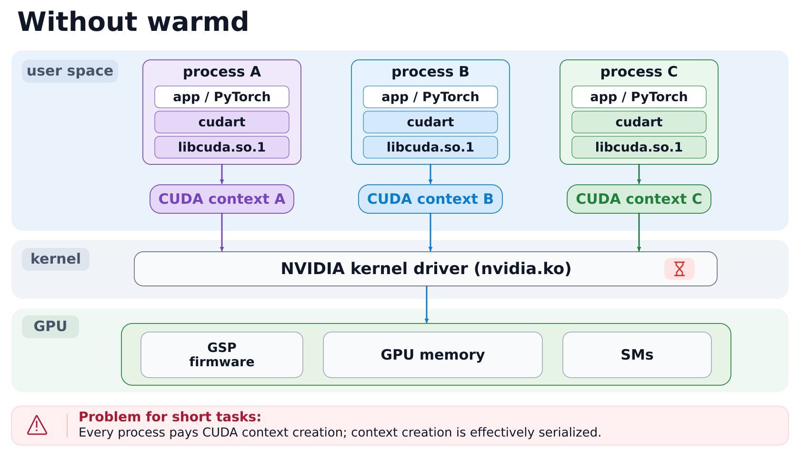
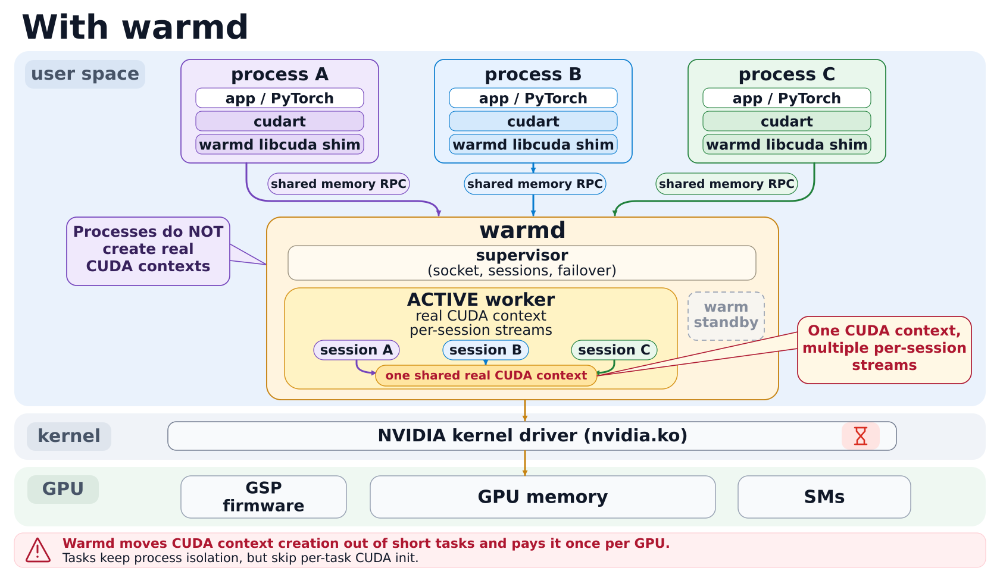

# warmd

A shared CUDA context for short-lived processes.

The warmd daemon holds one CUDA context per GPU. Programs that load warmd's `libcuda.so.1` send their driver calls to it, so they can `fork()` after CUDA is initialized. Use it for many short tasks in one trust domain. All its processes share one fault domain.

To share model weights between processes that keep their own contexts, use [gpu-segments](https://github.com/ziyangliu-666/gpu-segments). It does not need warmd. For many short kernels in one trust domain, also compare with NVIDIA MPS: the measurements are in [elastic-gpu-research](https://github.com/ziyangliu-666/elastic-gpu-research).





## Building

Needs Linux x86-64, NVIDIA driver 550 or newer, CUDA headers, gcc and make.

```console
$ make
$ build/warmd &
$ LD_LIBRARY_PATH=build/lib python3 -c 'import torch; print(torch.ones(2, device="cuda"))'
```

`tests/run.sh` runs the tests.

## Performance

Short PyTorch tasks on an A100 (driver 570, 8 vCPUs), each in its own process:

| | 1 at a time | 8 at a time |
|---|---:|---:|
| native, fork after `import torch` | 2.1/s | 4.5/s |
| warmd, fork after `import torch` | 8.1/s | 59/s |
| warmd, fork after CUDA warm-up | 42/s | 133/s |

Each call to the daemon adds 10 to 15 µs, and large copies run at 3 to 5 GB/s. Details in
[docs/perf.md](docs/perf.md).

## Documentation

[warmd(8)](docs/warmd.8.md), [deploying](docs/deploy.md), [Python package](docs/python.md),
[design](docs/design.md), [compatibility](docs/compat.md), [performance](docs/perf.md).

## License

Apache 2.0. See [NOTICE](NOTICE).
